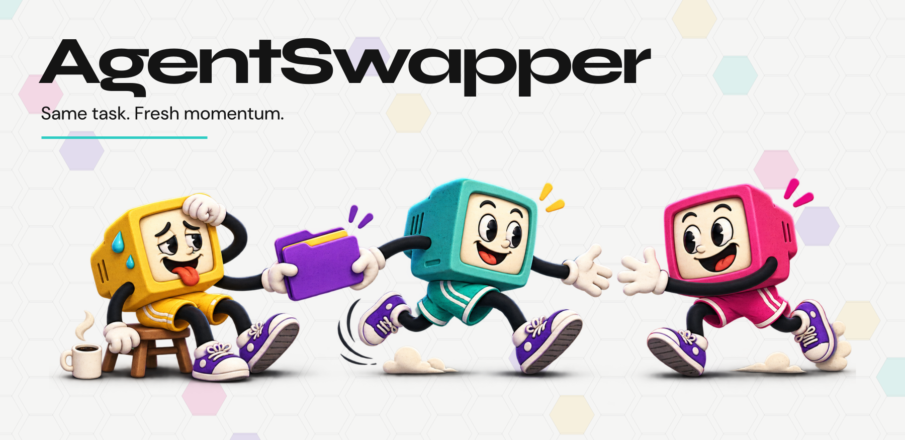
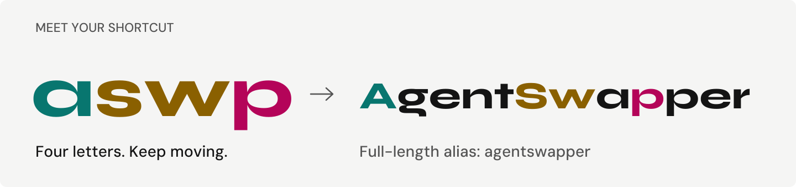

<picture>
  <source media="(prefers-color-scheme: dark)" srcset="assets/brand/readme-artwork-dark.png">
  
</picture>

# AgentSwapper

**Switch agents. Keep your place.**

AI coding agent and subscription switcher for Claude Code, Codex, and Kimi Code.

<picture>
  <source media="(prefers-color-scheme: dark)" srcset="assets/brand/command-dark.png">
  
</picture>

Meet **`aswp`**, short for **A**gent**Sw**a**p**per. Prefer the full name? Use `agentswapper`.

> Developer preview. Build from source; native integrations are experimental.

<picture>
  <source media="(prefers-color-scheme: dark)" srcset="assets/brand/handover-dark.png">
  
</picture>

## What we are building

- **Accounts, together.** Manage subscriptions and rotate to available capacity.
- **Context that travels.** Carry your goal, decisions, constraints, and next action.
- **Your rules.** Choose the route and see why a switch happens.
- **Private by design.** Local records, isolated profiles, encrypted backups, and control over where context goes.

## A better handover

Checkpoint the work. Switch accounts or agents. Verify the workspace. Continue.

Resume an existing session where supported. When changing agents, use a checked handover to carry the task forward.

[CLI guide](docs/cli.md) / [Build and contribute](CONTRIBUTING.md) / [Architecture](docs/architecture.md) / [Roadmap](docs/roadmap.md)

Licensed under [Apache-2.0](LICENSE). Artwork notices are in [THIRD_PARTY_NOTICES](assets/brand/THIRD_PARTY_NOTICES.txt).
