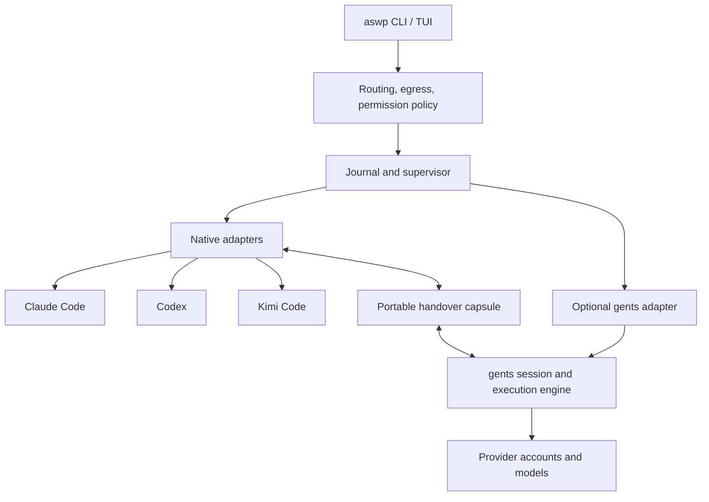

# gents integration evaluation

Reviewed 2026-10-27. Decision: **retain AgentSwapper's Rust control plane and
native adapters; qualify gents early as an optional execution engine. Reuse
small libraries only where they serve a concrete adapter.** No gents production
dependency or live-account support is introduced by this review.

This revises the earlier source-only assessment. gents addresses a substantial
part of our hardest problem: keeping canonical conversation history while the
execution engine changes provider or account. Rebuilding that engine ourselves
would duplicate significant work. Native CLI supervision and cross-engine
handover still require AgentSwapper's own implementation.

Implementation follow-up: the experimental attached-client option is now
available. See [engine setup and comparison](engines.md) for what it does and
[validation evidence](engine-validation.md) for its limits. This source review
does not qualify that runtime or any provider account.

## Scope and provenance

- Main: [`89f1b6760e2297b3d8a09d347c43eaf6978a8b31`][main], workspace 0.21.0,
  Apache-2.0, Rust 1.98, 25 workspace packages.
- Separately tested, **unmerged** replay branch:
  [`b4755abe7b737c91b386908fffeb045333d73eb1`][replay-branch], two commits beyond
  reviewed main. Its results must not be attributed to main or a release.
- Inspected history, account switching, request projection, OAuth custody,
  encrypted storage, process supervision, HTTP boundaries, package manifests,
  releases and tests. Built independent consumers and ran provider-free tests.
- Consulted Claude Opus 5.5 at xhigh effort in two restricted, read-only reviews:
  integration/continuity and security/reliability. Their source findings were
  checked against implementation and experiments; those reviews are not tests.
- No live provider requests, native credential migration, or account refresh
  experiments were performed. No full Windows/macOS runtime certification or
  complete workspace audit is claimed.

## What we gain

### One conversation across different providers

gents owns the agent loop, tools and canonical history. It renders that history
into each provider's request format. This is a practical route to the user's
desired experience: switch the account/model behind a conversation without
changing the visible frontend or manufacturing another CLI's private session
files. Its canonical messages retain text, tool calls/results and explicitly
typed provider reasoning. Request assembly strips reasoning when its provider
issuer or wire format differs. This is much richer than a summary-only handover.
See [message types][messages] and [request assembly][assembly].

The distinction is **engine versus interface**. `gents codex` launches the stock
Codex UI against gents' app-server shim, with Codex's own approvals and sandbox
bypassed. gents owns execution and permissions. This can provide a familiar UI,
but does not preserve native Codex execution semantics. We must label the engine
and permission owner before launch and throughout the session. There is no
equivalent Claude Code frontend shim in the inspected implementation.
See [Codex launcher][codex-launch].

Kimi/Moonshot is not a dedicated provider kind in this revision. A generic
OpenAI-compatible backend may support a Kimi API endpoint, but that is not
evidence of Kimi Code subscription or CLI compatibility. gents therefore does
not by itself complete our three-brand subscription requirement. Its Claude
subscription backend makes provider requests; it does not launch Claude Code.

### Subscription switching and durable continuation

The account-switch API selects enabled accounts of the **same provider**, rejects
known model mismatches, and transactionally moves an inference profile to the
selected backend. Shared companion profiles can move too. Usage-limit recovery
then continues the same goal/session using a durable source-request identity.
That already implements useful behavior we would otherwise need to create.
See [profile switching][switch] and [operator resume][resume].

An unread model inventory can remain eligible as “not read yet”; the API does
not prove availability in that case. Our automatic routing gate must preserve
the distinction between verified capability and missing observations.

There are two transactions: profile switching, then goal resumption. The code
explicitly handles the first succeeding while the second fails. Our adapter
must reconcile the receipt and retry the same source request; it must not
assume both operations are atomic or issue a second continuation blindly.

Cross-provider changes use a different path: the Codex model picker creates a
profile and rebinds the agent to an advertised model/backend. This is
**agent-wide**, not per-thread. `turn/start` does not apply its requested model
as a per-turn override. We need a dedicated gents agent/profile per AgentSwapper
lineage, or an upstream session-scoped operation, before promising isolation.
See [model selection][models] and [turn handling][turns].

Quota observations distinguish fresh, stale and unavailable data; unavailable
is not zero usage. There is operator-triggered alternate-account continuation
and opt-in resume at a known reset. These are valuable primitives, but do not
replace our multi-provider routing policy, egress rules, cost limits, cooldowns
or custody checks. A new account can also have a cold prompt cache.

### Useful reusable boundaries

| Component | Value to AgentSwapper | Decision |
|---|---|---|
| Full gents runtime | Persistent agent loop, history, account management, execution | Optional process integration; keep outside the default binary |
| `gents-loop` | Provider projection, replay, compaction, limit classification | Use through the engine initially; linking it alone means implementing many runtime services |
| `gents-protocol`, native feature disabled | Canonical message and control types | Qualified consumer candidate; preserve our independent capsule schema |
| `gents-codex-protocol` | Small, pinned Codex wire types | Candidate for the relevant protocol subset, with official-schema drift tests |
| `account_usage` / `provider_limit` | Freshness and quota/error parsing | Prefer a small upstream crate extraction when quota work needs it |
| `gents-fs-runner` | Bounded read-only listing/search | Useful if we add our own search; not needed to supervise native tools |
| Execution leases / conditional terminal writes | Stale-worker and crash-recovery patterns | Adopt the design principles where they fit our journal |

The Codex type crate describes the shim's supported subset, pinned to Codex
`c4e53d103c102f8d5201247adbc60bbddd47c88d`. It is not automatically a complete
native app-server client SDK. API checks for the loop, protocol and Codex
protocol crates returned no crates.io packages at review time; use immutable
git revisions or published releases when available.

## Experiments and results

Reproduction source and locked standalone consumers are in
[`tools/gents-evaluation`](../tools/gents-evaluation/README.md). They contain
our own test fixtures, not copied upstream implementation.

| Experiment | Result | What it establishes |
|---|---|---|
| External consumer: protocol, Codex protocol, filesystem runner | 4 tests passed | Public APIs work outside the upstream workspace; round trip, wire shape, bounded search and outside-base refusal |
| Same consumer, Windows MSVC target | Cross-typecheck passed | Types compile for that target; no Windows execution claim |
| Main: Claude-style completed tool pair projected to Responses | Failed before request dispatch: missing `call_id` | Concrete cross-provider history incompatibility in this public projection path |
| Identical regression on unmerged replay branch | Passed; 3 tests including mixed parallel history and quota aging | Branch repairs this fixture and preserves the canonical source history |
| Upstream Codex wire fixtures | 5 passed | Pinned wire fixtures hold locally |
| Upstream filesystem integration suites | 39 passed | Tested budgets, walking, patterns and ignore behavior |
| Upstream full loop suite | 218 passed, including Lean-backed conformance | Pinned local loop tests, not live provider acceptance |
| Upstream protocol suites | 68 unit tests + 1 provider-usage conformance test passed | Pinned canonical types and generated contract behavior |
| Full-runtime profile-switch suite | Build stopped for local resource pressure before tests ran | No runtime-switch, store-encryption or OAuth test pass is claimed |

The replay branch projects retained tool identities and removes foreign
provider item IDs from the Responses request. This is directly relevant to
AgentSwapper. These are still provider-free fixtures, not proof that every
account/model pair accepts a complete conversation. Expand coverage to nested tools, incomplete calls, compaction, images, long histories and reverse
direction before promotion. Never execute old tool calls merely to recreate
their results.

Same-provider account changes need a separate reasoning test. The inspected
replay issuer identifies provider family and endpoint, not the account. We have
not established that opaque/signed reasoning from account A is accepted by
account B. On unverified combinations, omit such reasoning and record the
continuity gap while retaining portable text and completed tool results.

## Security and reliability review

### Storage and token ownership

Persistent gents stores are encrypted by default using a 32-byte DefraDB engine
key. Custody is recorded before creation, a missing key for an existing store
is refused, and the legacy migration copies and verifies before replacing the
plaintext store. The default key backend is macOS Keychain on macOS and a
private file on other platforms. This corrects any impression that credentials
are necessarily plaintext merely because their in-memory fields are strings.
See [store key implementation][store-key].

A file key beside the database does not protect against theft of the entire
home directory or a compromised process running as that user. The non-Unix
file path also needs explicit Windows ACL qualification. Encryption does not
authorize callers of the running node.

gents owns its OAuth login and refresh flow, including redacted debug output,
shared bearer state, refresh coordination and conditional persistence. We
should let it own those credentials exclusively. Do not copy native CLI tokens
into gents or put its tokens in AgentSwapper's SQLite log. The inspected refresh
failure path retains a rotated token in memory after repeated persistence
failure; a crash before durable recovery remains a scenario to test. See
[OAuth credential implementation][oauth].

Subscription access through a different client is a distinct compatibility and
authorization question from possessing a valid login. No terms or entitlement
conclusion is established by these source tests. Native subscription support
must remain available independently of optional engine qualification.

### Local API boundaries

The Codex shim rejects wildcard binds and requires authentication for
non-loopback TCP, but a loopback listener can be unauthenticated. Its handshake
accepts requests when no token is configured. No Origin check was found in that
handler. For our integration, require authenticated private IPC or authenticated
loopback with an explicit Host/Origin policy. A token must not appear as an argv
value or in the event journal. See [shim server][shim].

Several gents GET routes, including `/sessions`, `/self` and `/status`, do not
apply caller authentication in their handlers. They use the node's authority
for metadata reads. The Defra HTTP server merges these extra routes **after**
applying its route middleware, so its ordinary document-read permission gate
does not automatically cover them. Treat session/workspace metadata as private
in an AgentSwapper-managed instance. This is a source finding, not a demonstrated
browser exploit. Enrollment still requires approval; an enrollment offer alone
does not grant access. See [gents routes][routes] and [Defra route merge][merge].

Do not generalize this finding to anonymous raw GraphQL credential access.
Defra has explicit document-read permissions and dynamic GraphQL authorization;
gents enables node access control. Its agent query tool separately blocks
credential fields, including nested filters. Those boundaries need dedicated
negative tests in the integration contract.

### Replication and process custody

Normal client replication excludes OAuth credentials and inference backends,
and application pairing rejects protocol-owned credential collections.
Operator replication profiles can include inference backends, which may contain
API-key material. We have not proven an unauthorized replication path. Start
the optional integration with P2P transport disabled and do not request remote
replication capabilities.

The runtime's managed process implementation is useful but is not a drop-in
replacement for our custody requirement. Unix process groups can be escaped;
normal leader exit does not necessarily mean descendants stopped. Windows uses
suspended launch, job assignment and kill-on-close, but restart reconciliation
and the entire AgentSwapper transfer protocol still need verification. Keep
our supervisor, durable ownership and unknown-custody refusal. A generation
number fences cooperating writers; it does not stop arbitrary shell processes.

The read-only filesystem runner is also not a general sandbox: validating a
canonical path and subsequently opening it needs separate race analysis in
hostile workspaces. Passing our outside-base fixture does not establish a
capability-secure filesystem boundary.

### Dependency surface

The independent minimal consumer resolves 140 packages; the native loop
consumer resolves 264, including target/dev closure. Neither brings in the full
gents runtime, DefraDB, Iroh or Wasmtime. Counts describe these locked consumers,
not installed size or the number of production dependencies on every target.

Our fresh minimal consumer passed advisory and license policy checks. The fresh
loop consumer had no advisory findings, but our narrow license allowlist
rejected five packages involving ISC, MIT-0 and CDLA-Permissive-2.0. Those are
policy-review tasks, not evidence of license incompatibility. Product policy
was not loosened for the experiment.

The **full upstream locked graph** produced 24 cargo-deny errors: 13 vulnerability
occurrences, 2 unsoundness findings, 4 unmaintained packages and 5 yanked-version
findings. Occurrences include duplicate versions and platform/dev dependencies;
this is not 24 proven reachable exploits. Before bundling a runtime, triage the
actual selected features/targets and update or explicitly resolve findings.
The [machine-readable snapshot](../tools/gents-evaluation/advisory-snapshot.json)
records all finding categories, packages and advisory IDs. Examples include:

| Dependency | Advisory / required analysis |
|---|---|
| `crypto-bigint` 0.5.5 | [RUSTSEC-2026-0387](https://rustsec.org/advisories/RUSTSEC-2026-0387), timing behavior in cryptographic operations |
| `h2` 0.4.13 | [RUSTSEC-2026-0258](https://rustsec.org/advisories/RUSTSEC-2026-0258), unbounded empty DATA frames |
| `rmcp` 1.3.0 | [RUSTSEC-2026-0189](https://rustsec.org/advisories/RUSTSEC-2026-0189), DNS rebinding; inspect enabled transport |
| `rsa` 0.9.10 | [RUSTSEC-2023-0071](https://rustsec.org/advisories/RUSTSEC-2023-0071), timing attack; inspect actual RSA use |
| `tokio` 1.51.1 | [RUSTSEC-2026-0386](https://rustsec.org/advisories/RUSTSEC-2026-0386), AsyncFd I/O safety |
| `zstd` / `zstd-safe` | [RUSTSEC-2026-0391](https://rustsec.org/advisories/RUSTSEC-2026-0391), [0398](https://rustsec.org/advisories/RUSTSEC-2026-0398), [0403](https://rustsec.org/advisories/RUSTSEC-2026-0403); context reuse, seekable and legacy decoder paths differ |

The runtime also pins several git forks. In particular, downstream users of
`gents-loop` must repeat the root rig patch: dependency workspace patches are
not transitive. Default features off does not remove the full runtime's
unconditional database/network dependencies. A process boundary reduces
coupling and preserves a small default CLI, but does not eliminate runtime
security responsibilities.

## Integration design



Keep four distinct identities: **frontend, engine, provider, account**. A Codex
frontend connected to gents using an Anthropic account must not be displayed
simply as a native Codex session. The optional engine keeps its own credentials
and history. AgentSwapper records opaque references, policy, custody and
switch receipts. No direct writes to gents' internal database.

For the user, target three honest continuity labels:

1. **Resume** — tested native resume within a compatible harness/account cell.
2. **Continue in this conversation** — gents projects its history to a qualified
   provider/account pair, showing any dropped reasoning or cache reset.
3. **Handover** — move between engines/harnesses using a capsule and reconciliation.

The existing `/handover` and pickup skills remain useful for the third path.
They carry work state; they do not transfer permissions, stop writers, or grant
the receiving engine access to tools. Engine changes retain the stop/checkpoint/
reconcile/validate sequence and the egress policy. Same-engine switching must
also reach a safe boundary and reconcile outstanding tool effects.

Proposed CLI shape, **not implemented**:

```text
aswp run work --engine native
aswp run work --engine gents --frontend codex
aswp switch --to backup
aswp doctor --engine gents
```

The same switch action selects a compatible mechanism. Its preview names source
and target engine/provider/account, continuity level, permissions and cost
changes. Once covered by the user's routing policy, it should not repeatedly
ask for confirmation. Unknown custody or an uncovered disclosure pauses safely.

## Options and next qualification gates

| Option | Assessment |
|---|---|
| Replace AgentSwapper with the full gents runtime | Would accelerate a unified engine, but absorb broad runtime/platform obligations and leave native CLI switching unsolved |
| Link only `gents-loop` and build our own runtime | Smaller than the full engine, but recreates credential/session/tool/approval services; premature |
| Native core + optional gents process + selected libraries | **Selected**: gains unified continuity while keeping native compatibility and independent release boundaries |
| Ignore gents and rebuild everything | Duplicates substantial work and misses a useful collaboration opportunity |

Run G0 alongside native M0, not after the tray or extended-scope milestones:

1. Establish a pinned, versioned local contract for capability/status, quota,
   interrupt, switch/resume receipts and context export. Prefer narrow scoped
   APIs to parsing human CLI output or exposing an administrator GraphQL client.
2. Require authenticated local access, isolated agent/profile scope and P2P off.
   Test unauthenticated metadata and mutation refusal, cross-session isolation,
   token redaction, crash/retry and uncertain tool outcomes.
3. Merge or pin the replay fix after review; expand provider-pair fixtures and
   account-bound reasoning behavior. Keep the provider matrix unverified until
   actual provider tests pass.
4. Qualify a Linux engine launch/stop/reconnect fixture and then actual Windows
   and macOS cells. Existing release evidence emphasizes Linux and Apple Silicon;
   the consumer Windows typecheck does not qualify the full runtime.
5. Resolve selected-runtime dependency findings and license notices, and prove
   permission ownership using the real frontend. Do not infer safety from the
   native UI's appearance.

Potential joint work with the authors: small published quota/protocol crates,
stable session-scoped switch/export APIs, broader replay fixtures, private local
transport and Windows key ACLs. These are discussion points only; no messages or
upstream issues were sent as part of this evaluation.

## Final test checkpoint

All 218 loop tests and 69 protocol tests passed after Lean 4.18.0 built the
required contracts. With the 5 Codex wire and 39 filesystem tests, **331 upstream
tests passed locally**. The independent minimal consumer passed 4 tests and the
replay-branch consumer passed 3. Reviewed main deliberately fails both of our
history-projection regression cases; its quota-aging case passes. The Windows
consumer cross-typecheck passed. See the
[result record](../tools/gents-evaluation/results.json) for pinned revisions,
scope and log hashes. Provider support remains unverified.

The monolithic runtime unit-test build was stopped after more than 40 minutes
in a shared WSL environment with 11 GiB RAM. The compiler held approximately
9 GiB across resident and swapped memory while the Lean build was also active,
causing heavy paging. This is a local evaluation limit, **not an upstream test
failure**. The planned profile-switch, encrypted-store, OAuth-race, managed-exec
and goal-resume runtime tests did not execute. Their implementation findings
above are source-reviewed, and those tests remain required before integration.

Initial attempts also exposed environment prerequisites: Lean 4.18.0 and the
Rust `wasm32-unknown-unknown` / `wasm32-wasip1` targets. These were installed
locally for the evaluation. Missing-tool failures are not source defects.
The pinned upstream runtime and Lean CI jobs were marked cancelled when queried;
unrelated successful reconciliation jobs do not supply missing test evidence.

To repeat the upstream checks in a suitable build environment, use the reviewed
checkout, put Lean 4.18.0 on PATH, enable CLI git fetching if required by local
Git configuration, and run:

```sh
cargo test --locked --no-default-features -p gents-loop -p gents-protocol \
  -p gents-fs-runner -p gents-codex-protocol -j2
cargo test --locked -p gents --lib config_client::profile_switch::tests:: \
  -j2 -- --test-threads=2
```

Use the same runtime command with `store_key::`, `oauth_credential::`,
`managed_exec::`, `goal::operator_resume::` and `goal::reset_resume::` filters.
Keep fixture execution isolated from real accounts and retain a larger worker
stack where needed (`RUST_MIN_STACK=16777216` was used for the runtime attempt).

[main]: https://github.com/gents-ai/gents/tree/89f1b6760e2297b3d8a09d347c43eaf6978a8b31
[replay-branch]: https://github.com/gents-ai/gents/commit/b4755abe7b737c91b386908fffeb045333d73eb1
[messages]: https://github.com/gents-ai/gents/blob/89f1b6760e2297b3d8a09d347c43eaf6978a8b31/crates/gents-protocol/src/message.rs
[assembly]: https://github.com/gents-ai/gents/blob/89f1b6760e2297b3d8a09d347c43eaf6978a8b31/crates/gents-loop/src/loop_stream/request_assembly.rs
[codex-launch]: https://github.com/gents-ai/gents/blob/89f1b6760e2297b3d8a09d347c43eaf6978a8b31/crates/gents-cli/src/commands/codex.rs
[switch]: https://github.com/gents-ai/gents/blob/89f1b6760e2297b3d8a09d347c43eaf6978a8b31/crates/gents/src/config_client/profile_switch.rs
[resume]: https://github.com/gents-ai/gents/blob/89f1b6760e2297b3d8a09d347c43eaf6978a8b31/crates/gents/src/goal/operator_resume.rs
[models]: https://github.com/gents-ai/gents/blob/89f1b6760e2297b3d8a09d347c43eaf6978a8b31/crates/gents-cli/src/commands/codex_shim/handlers/models.rs
[turns]: https://github.com/gents-ai/gents/blob/89f1b6760e2297b3d8a09d347c43eaf6978a8b31/crates/gents-cli/src/commands/codex_shim/handlers/turns.rs
[store-key]: https://github.com/gents-ai/gents/blob/89f1b6760e2297b3d8a09d347c43eaf6978a8b31/crates/gents/src/store_key.rs
[oauth]: https://github.com/gents-ai/gents/blob/89f1b6760e2297b3d8a09d347c43eaf6978a8b31/crates/gents/src/oauth_credential.rs
[shim]: https://github.com/gents-ai/gents/blob/89f1b6760e2297b3d8a09d347c43eaf6978a8b31/crates/gents-cli/src/commands/codex_shim/server.rs
[routes]: https://github.com/gents-ai/gents/blob/89f1b6760e2297b3d8a09d347c43eaf6978a8b31/crates/gents-cli/src/http/router.rs
[merge]: https://github.com/sourcenetwork/defradb.rs/blob/de0677ea3fb1ceb3f6ccb9d7fd6d4ef41b7878fc/crates/http/src/server.rs
